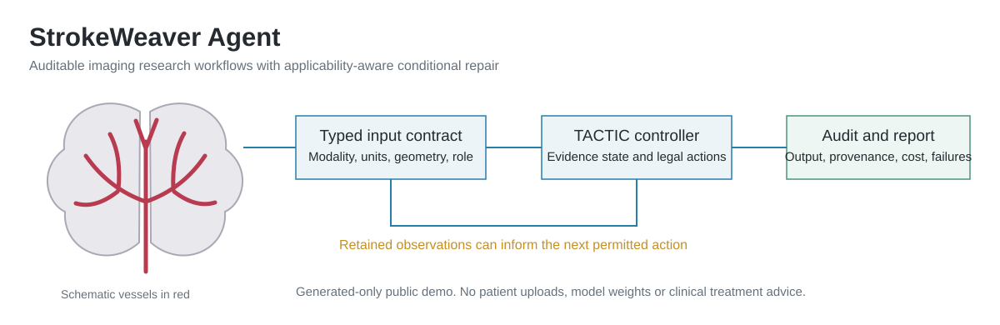
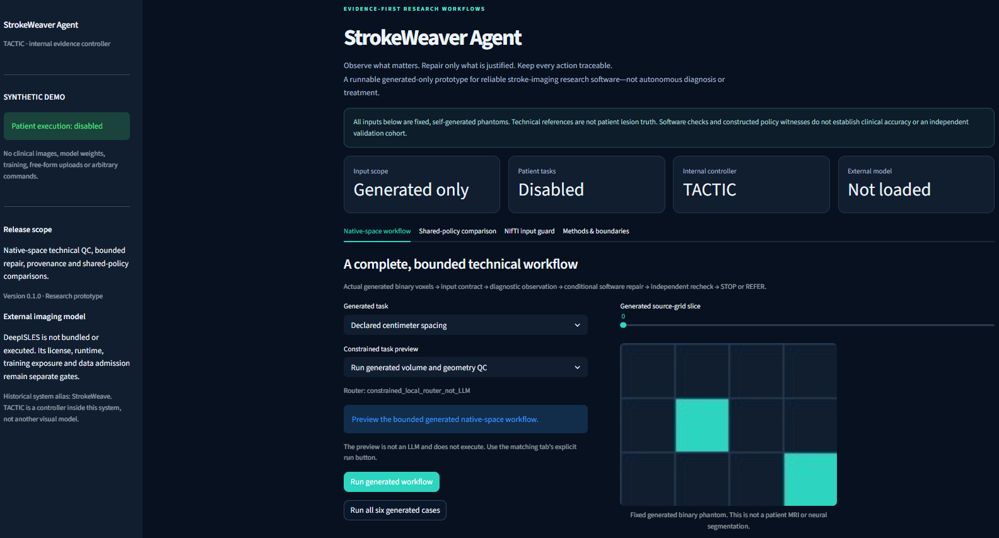

# StrokeWeaver Agent

**Evidence-first, auditable research workflows for stroke-imaging software.**

[中文说明](README.zh-CN.md) · [Architecture](docs/ARCHITECTURE.md) · [Deployment](docs/DEPLOYMENT.md) · [Reproducibility](docs/REPRODUCIBILITY.md)



*Original system schematic. This is not a screenshot, patient image or clinical result.*



*Actual local application view supplied by the operator on 5 November 2026, reproduced without image modification. It shows fixed generated voxels, not a patient MRI or neural segmentation. This single view is not a complete visual or clinical acceptance test.*

## What this release is

StrokeWeaver Agent is a runnable **generated-only research prototype** for evidence applicability, bounded technical repair, provenance and fair policy comparison.
It performs actual computation on small self-generated inputs rather than presenting a static mock interface.
Its public interface does not accept patient files, model checkpoints, external URLs or shell commands.

The repository is [shumao469/StrokeWeaver-Agent](https://github.com/shumao469/StrokeWeaver-Agent).
A hosted Streamlit application has **not yet been verified as deployed**; no live-app URL is claimed here.

### One system, three names

| Name | Meaning |
| --- | --- |
| **StrokeWeaver Agent** | The complete research software system and current public brand. |
| **TACTIC** | The internal evidence-applicability and conditional-repair controller. It is not a separate imaging model. |
| **StrokeWeave** | A historical development alias retained only in source provenance. |

Python package: `strokeweaver_agent`. Distribution: `strokeweaver-agent`.

## Implemented features

| Capability | What actually runs | Important boundary |
| --- | --- | --- |
| Native-space workflow | Generated binary voxels → checks → diagnostic observation → permitted repair → technical recheck → STOP/REFER. | Spatial arithmetic, not lesion segmentation accuracy. |
| Conditional repair | Fixed unit and axis-context examples, dependency invalidation and a bounded transient-failure example. | No arbitrary repair, file rewriting or inferred clinical correction. |
| Evidence state | Source hashes, context/dependencies, applicability, observed versus adopted state and invalidation trace. | Logging or retaining an observation does not make it valid. |
| Shared-policy comparison | Deterministic workflow, true rolling one-step, two-step cascade, complete finite VOI and TACTIC. | TACTIC intentionally shares the finite planner with full VOI here. |
| Mechanism ablation | Retain, mask or replace an initial observation; optionally fix its sunk acquisition cost. | Applied to every policy, not only a weaker baseline. |
| Input guard | Real generated NIfTI-1 bytes with bounded dimensions, provenance, millimetre geometry and modality checks. | Only a strict generated subset, not a general clinical reader. |
| Task preview | Constrained local keyword routing for supported generated tasks. | Not an LLM, open-ended planner or execution permission. |
| Audit export | JSON, readable HTML and ZIP created in memory; package-source and report SHA-256. | A hash is an integrity check, not an authenticated clinical certificate. |
| Research interface | Streamlit tabs, actual generated phantom slices, traces, policy tables and downloads. | No uploads, patient processing or external model execution. |

## Quick start: standard-library core

Use Python 3.11 or 3.12 for the documented setup. The package declares Python ≥3.10.
No GPU, Torch, model weights or patient dataset is required.

```bash
git clone https://github.com/shumao469/StrokeWeaver-Agent.git
cd StrokeWeaver-Agent
python run.py --help
python run.py demo --fixture centimeter_encoded
```

The command prints an actual generated audit to standard output.
It does not write into a private workspace or read an input image path.

### Optional isolated environment

```bash
python -m venv .venv
```

Activate it on Linux/macOS:

```bash
source .venv/bin/activate
```

Or in Windows PowerShell:

```powershell
.venv\Scripts\Activate.ps1
```

Install the package if you want the console entrypoint and imports:

```bash
python -m pip install -e .
strokeweaver tools
python -m strokeweaver_agent --help
```

If local PowerShell policy prevents activation, invoke the environment's Python directly rather than changing system-wide policy.

## Run the interactive demo

The interface dependency is pinned in `requirements.txt`:

```text
streamlit==1.55.0
```

```bash
python -m pip install -r requirements.txt
python -m streamlit run streamlit_app.py --server.address 127.0.0.1 --server.port 8810
```

Open `http://127.0.0.1:8810/` on the same machine.
The public app is separate from any historical private status monitor.
Changing a selector does not silently rerun a stored result; use an explicit run button.

The four tabs provide:

1. **Native-space workflow:** six fixed generated fixtures, a binary-voxel slice, action trace and STOP/REFER result.
2. **Shared-policy comparison:** all strong controls, exact toy quantities and observation interventions.
3. **NIfTI input guard:** generated geometry/component selection and 23 positive/typed-failure cases.
4. **Methods & boundaries:** component hierarchy, tool metadata and scientific limitations.

The phantom display is generated from actual binary voxels. It is **not an MRI scan or neural-model output**.

## Command-line examples

Run all six generated spatial tasks:

```bash
python run.py demo --fixture all
```

Compare all declared task families with shared retained evidence:

```bash
python run.py compare --scenario all --mode retain
```

Run the observation intervention with an initial observation and its cost held fixed:

```bash
python run.py compare --scenario witness --mode mask --fixed-observation
python run.py compare --scenario witness --mode uninformative --fixed-observation
```

Check every registered generated input case, including expected rejections:

```bash
python run.py input-check --all-cases
python run.py input-check --mode SEALS_component --case left_handed
```

Preview a supported intent without executing it:

```bash
python run.py plan "Run generated volume and geometry QC"
python run.py tools
```

JSON is the default. Task commands also support `--format html`.
For example, you may explicitly save generated output using your shell:

```bash
python run.py demo --fixture centimeter_encoded --format html > generated_report.html
```

Do not substitute patient information in a task request. The router rejects clinical requests, external paths, URLs, executable commands and attempts to override safeguards.

## Python API

After installing the package:

```python
from strokeweaver_agent import api, audit

report = api.run_demo("centimeter_encoded")
assert api.verify_audit(report)
print(report["payload"]["workflow"]["terminal"])

comparison = api.compare_policies("witness", mode="retain")
for row in api.comparison_rows(comparison):
    print(row["Policy"], row["Utility (toy)"])

html_text = audit.to_html(report)
zip_bytes = audit.export_zip(report)
```

Other supported functions:

| API | Result |
| --- | --- |
| `api.run_batch()` | All six generated workflows and a scoped aggregate. |
| `api.check_generated_input(case, mode, fault)` | One registered generated input contract and evidence handover. |
| `api.check_all_inputs()` | All 23 fixed input-contract cases. |
| `api.tool_registry()` | Generated tools and disabled external-model metadata. |
| `api.source_bindings()` | Hashes of this package's own implementation files. |
| `routing.preview(text)` | A bounded intent preview; never starts execution. |

Reports contain `schema`, `system`, `internal_controller`, `scope`, `payload`, `source_bindings`, `cost` and `audit_sha256`.
The API wall-time field excludes CLI/UI startup, rendering, export and deployment.
Recomputing a hash after modification is not a trusted signature; do not treat `verify_audit()` as proof of authorship or clinical validity.

## What the policy example demonstrates

For the original declared witness, with retained evidence and no fixed-prefix intervention:

| Shared policy | Exact expected toy utility |
| --- | ---: |
| Dependency-aware deterministic workflow | 7 |
| Strong rolling one-step gate | 6 |
| Strong two-step cascade | 7 |
| Complete finite VOI | 7 |
| TACTIC demonstration | 7 |

This shows a possible nonmyopic opportunity in a **constructed finite task**, not superiority over a strong deterministic workflow.
The redundant-observation control ties at 7.25; the unresolvable control returns REFER.
All policies share legal acquired history, actions, tools, recovery, budgets and the root risk set.
The mean/CVaR limits in this small family are redundant; this is not evidence of a new separable dual-risk method.

The code accepts ties and negative results. It does not require every task to trigger a modification.

### Release verification snapshot

The 2026-11-05 public-package test run passed **70/70 tests**, including a real Streamlit AppTest interaction test, with exit code 0.
That test exercised generated STOP/REFER behavior, the shared comparison, input rejection and absence of uploads.
It is not browser screenshot inspection, an independent patient sample or a clinical validation result.
These are the public-package tests, **not** the older private V2 milestone's heterogeneous 61/120/81/37 check counts.
After changing code or dependencies, rerun the suite; do not carry this snapshot forward as a fresh pass.

## DeepISLES and real data

DeepISLES is an external project; its runtime, checkpoints and third-party inference code are **not bundled or executed** by this public demo.
The registry records a full DWI+ADC+FLAIR ensemble contract and a distinct prospective DWI+ADC SEALS-component contract.
Missing FLAIR is not permission to advertise the full ensemble.
ISLES training exposure must be disclosed; the tool must not be called unseen on its training family.

A real-data extension requires separate source/checkpoint/dependency rights, a qualified runtime, lawful data roles, patient/exam grouping, history and exposure review, native-space QC and an independently bound reference.
Matching headers do not prove biological registration, effective brain coverage or lesion correctness.
No such admission is granted by running this repository.

## Reproducibility and provenance

```bash
python -m unittest discover -s tests -v
python examples/reproduce.py
```

Core-only environments can omit the optional Streamlit smoke test dependency; report any skips rather than claiming a full UI test pass.
Test counts are software checks, not clinical sample sizes.
See [Reproducibility](docs/REPRODUCIBILITY.md) for scope, fixtures, comparisons and the historical C3 correction.

`legacy/source_index.json` describes the curated owned implementation and adaptations.
Historical source is not a second active app or authority to rerun private experiments.
Old patient files, protected CAL/HOLD statistics, correspondence, credentials, external weights and private daemons are intentionally excluded.

## Deployment and release status

The application can be launched locally now. Community Cloud deployment requires the repository owner to sign in and select the repository, branch and `streamlit_app.py` entrypoint.
Use the pinned requirements and Python 3.11/3.12; no secrets are required for this generated-only app.
See [Deployment](docs/DEPLOYMENT.md). A deployment is not considered verified merely because a repository exists or a local health endpoint responds.

Actual UI screenshots should only be labelled screenshots after capture and inspection. The overview graphic above is a schematic.

## Research and safety boundary

This release does not establish independent patient performance, clinical safety, treatment value, reduced physician workload, cross-tool generalization or a 20% end-to-end speedup.
It introduces no new visual-network architecture and does not claim memory, recovery, VOI or constrained planning as first inventions.
It is not an autonomous clinical system and must not guide diagnosis or treatment.

The scientific question remains whether applicable retained observations improve **complete real research tasks** under strong shared controls and fixed risk/cost rules.
That claim requires separate independent evidence; publication quality is not certified by a polished interface or software-test count.

## License and third-party materials

The owner has not yet selected a distribution/reuse license for this repository.
Do not infer MIT, Apache-2.0 or an upstream data license from public source visibility or dependency installation.
Third-party software, model and dataset terms remain separate; no clinical-use authorization is supplied here.

For a bug report, include the commit, Python version, generated fixture/command and a minimal generated-only reproduction.
Do not upload patient data, protected outputs, credentials or access tokens to issues.
