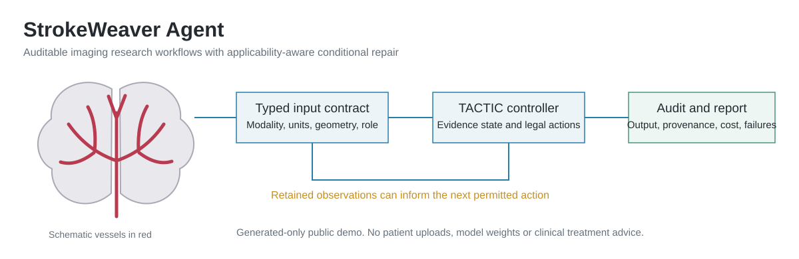
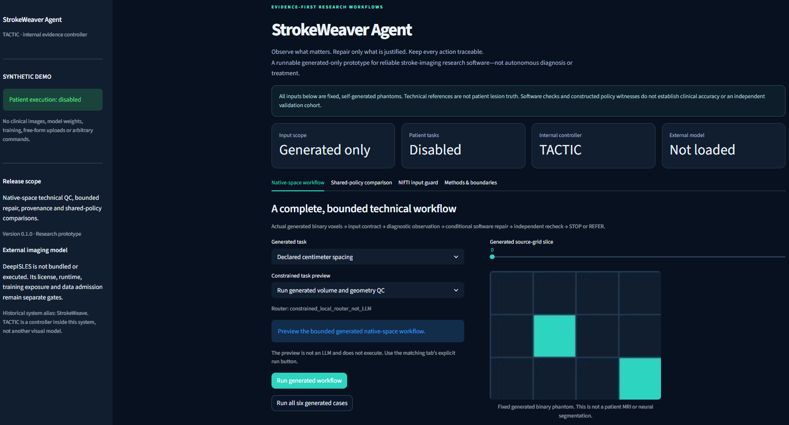

# StrokeWeaver Agent

**面向卒中影像科研软件的证据驱动、可审计工作流原型。**

[English](README.md) · [架构](docs/ARCHITECTURE.md) · [部署](docs/DEPLOYMENT.md) · [复现与边界](docs/REPRODUCIBILITY.md)



上图是原创示意图，不是界面实拍、患者MRI或临床结果。



这是用户于2026年11月5日提供的真实本机界面截图，未修改图像内容。显示的是固定生成体素，并非患者MRI或神经网络分割；单张截图不等于完整浏览器验收或临床验证。

## 定位与命名

- **StrokeWeaver Agent**：完整系统及当前公共名称。
- **TACTIC**：系统内部的证据适用性与条件修复控制器，不是并列的影像模型。
- **StrokeWeave**：历史开发别名，仅在来源记录中保留。

公共仓库：[shumao469/StrokeWeaver-Agent](https://github.com/shumao469/StrokeWeaver-Agent)。
此版本是可运行的**仅生成输入科研原型**；尚不声称已有核验通过的公共Streamlit部署链接。

## 已实现什么

| 模块 | 实际能力 | 边界 |
| --- | --- | --- |
| 原生空间工作流 | 生成二值体素、质量核验、诊断观察、允许的技术修复、重检与STOP/REFER。 | 不是患者病灶分割效能。 |
| 证据状态 | 哈希、来源/空间依赖、适用性、已观察与已采纳分离、失效记录。 | 保存证据不等于证据有效。 |
| 公平策略比较 | 确定性流程、真实滚动一步、两步级联、完整有限VOI、TACTIC。 | TACTIC在此共享完整有限规划器，不是新算法。 |
| 观察消融 | 保留／屏蔽／无信息，并可固定已付调用成本。 | 所有策略接受同样消融，强基线不被剥夺合法历史。 |
| NIfTI输入守卫 | 实际生成NIfTI字节、模态、单位、网格、来源及有界形状检查。 | 仅严格生成子集，不是通用临床读取器。 |
| 任务预览 | 支持固定生成任务的本地关键词路由。 | 不是LLM，也不自动执行自由文本。 |
| 报告导出 | 内存中生成JSON、HTML、ZIP及内容/源码哈希。 | 哈希不是临床安全或身份认证证书。 |

## 快速运行

建议Python 3.11或3.12；核心声明支持≥3.10，使用标准库，不需要GPU、Torch或模型权重。

```bash
git clone https://github.com/shumao469/StrokeWeaver-Agent.git
cd StrokeWeaver-Agent
python run.py demo --fixture centimeter_encoded
python run.py demo --fixture all
python run.py compare --scenario all --mode retain
python run.py input-check --all-cases
python run.py plan "Run generated volume and geometry QC"
python run.py tools
```

任务默认向终端输出JSON；可加`--format html`。CLI不接收外部影像路径或任意命令。

## 交互界面

建议在独立虚拟环境中安装，避免影响其他研究环境：

```bash
python -m venv .venv
python -m pip install -r requirements.txt
python -m streamlit run streamlit_app.py --server.address 127.0.0.1 --server.port 8810
```

安装前请激活该虚拟环境，或使用其Python完整路径；Linux/macOS用`source .venv/bin/activate`，Windows PowerShell用`.venv\Scripts\Activate.ps1`。
界面依赖固定为`streamlit==1.55.0`。本机访问`http://127.0.0.1:8810/`。

四个标签页提供生成空间任务、共享策略对照、NIfTI守卫和方法边界。
显示的切片来自实际生成的二值体素，不是MRI或神经分割结果。
更改选项不会悄悄重跑旧报告；通过明确按钮执行。
完整API和导出示例见[英文README](README.md)。

## 结果应该怎样解释

原始构造例中：确定性流程、两步级联、完整VOI和TACTIC效用均为7，真实滚动一步为6。
冗余观察对照全部7.25；不可解决对照均REFER。
它证明有限构造任务中存在非短视机会，不证明TACTIC独有优势或患者获益。
本任务的均值与CVaR约束数学上冗余，不能包装成新的双风险方法。

保留／屏蔽／无信息是机制消融，不是让强基线少看信息的主比较。
期望调用是玩具模型量，不是临床时延；增加效用也可能需要更多调用。
软件检查、分支及计时重复均不能充当独立患者样本量。

本次公共包在2026-11-05完成**70/70项测试**，包含真实Streamlit AppTest交互，退出码0。
这不是旧私有V2的61/120/81/37检查计数，也不是浏览器截图验收或临床验证；修改代码后须重新测试。

## 真实影像与DeepISLES

公共版本**不包含、不加载、不执行**DeepISLES权重或推理代码。
完整集成需要DWI、ADC、FLAIR；DWI+ADC的SEALS单组件合同单独标注，不能冒称完整集成。
ISLES训练暴露须披露，不能在同源数据上称“未见工具”。
真实扩展仍需合法数据/模型许可、独立运行时、患者/检查及重复关系、历史角色排除、工具暴露、参考语义和原生空间QC。
相同头文件不等于生物学配准、有效脑组织覆盖或病灶正确；运行本仓库不会自动获得患者准入。
不能用于自主诊断、治疗选择或临床处置。

## 复现与历史

```bash
python -m unittest discover -s tests -v
python examples/reproduce.py
```

缺少可选Streamlit依赖时，须如实记录UI测试跳过，不能写成完整界面测试通过。
`legacy/source_index.json`记录自有历史代码及接续改造；不包含患者、标签、权重、凭据或私有环境。
历史C3负结果保留，但后续联合后验/统一计账纠错已暂停旧“精确上界／近视最优”解释；不能当当前有效主比较。

## 部署、许可与收尾边界

Streamlit云部署需要仓库所有者登录、选择仓库/分支和`streamlit_app.py`，详见[部署文档](docs/DEPLOYMENT.md)。
此生成应用不需要任何患者账号、密钥或访问token。
仓库存在、HTTP在线或AppTest通过不等于已完成真实浏览器视觉验收或临床验证。

仓库所有者尚未选择分发/复用许可证；不得擅自推定MIT、Apache-2.0或继承上游数据许可。
当前可以整理研究软件及证据边界；独立真实任务获益、复核负担与迁移能力仍未建立，不保证Nature子刊水平或录用。
报告问题时仅提供生成输入复现、提交版本和环境信息，不上传患者资料、保护输出或凭据。
