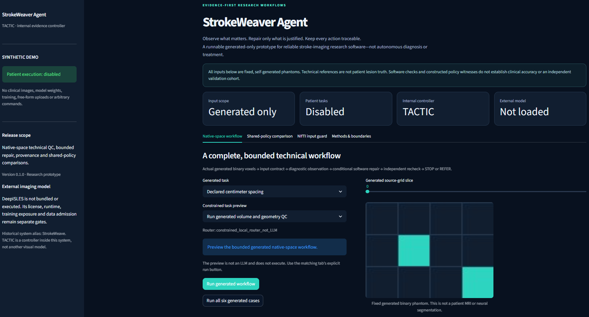

# StrokeWeaver 1.0

StrokeWeaver 1.0 is an interactive research workbench for auditable stroke-imaging software workflows. It uses generated voxel phantoms to demonstrate native-grid checks, bounded technical repair, evidence tracking, and comparisons among decision policies. **TACTIC** is the evidence and conditional-repair controller within StrokeWeaver.



*The workbench displays a generated voxel phantom and controls for spatial quality checks.*

## Start the workbench

Install Python 3.11 or later and clone the repository. From the repository root, install the shared interface dependency and start the unified workbench:

```bash
git clone https://github.com/shumao469/StrokeWeaver-Agent.git
cd StrokeWeaver-Agent
python -m pip install -r requirements.txt
python -m streamlit run streamlit_app.py --server.address 127.0.0.1
```

Open `http://127.0.0.1:8501/` and select **1.0 · Generated workflow** in the sidebar. To launch the standalone interface instead:

```bash
cd StrokeWeaver-1.0
python -m pip install -r requirements.txt
python -m streamlit run streamlit_app.py --server.address 127.0.0.1 --server.port 8810
```

The standalone interface opens at `http://127.0.0.1:8810/`. The unified workbench uses the dependency version pinned in the root `requirements.txt`; the standalone folder maintains its own pinned interface dependency.

## Explore the native-space workflow

1. Open **Native-space workflow** and choose a **Generated task**. The six cases cover a valid grid, centimeter spacing, an axis-order conflict, a non-binary input, unknown units, and a transient tool failure.
2. Use **Generated source-grid slice** to inspect a plane of the generated phantom. The viewer displays the input shape, spacing, unit, axis information, and input hash.
3. Select a **Constrained task preview** to see the supported route. Run a task with **Run generated workflow**, or select **Run all six generated cases** for a batch summary.
4. Review the terminal state, charged calls, measured API wall time and audit-hash status. The action trace records operations and failures; the evidence table shows observations and adoption status.
5. Open **Complete generated audit and dependency invalidations** for the full record. Download the audit as JSON, readable HTML, or a ZIP evidence bundle.

**STOP** marks completion of the generated technical workflow. **REFER** identifies an input that needs review. The voxel phantom and volume are generated software test inputs for spatial arithmetic.

## Compare decision policies

In **Shared-policy comparison**, choose a declared task family and an observation intervention, then select **Run shared-policy comparison**. The comparison includes a dependency-aware deterministic workflow, rolling one-step gate, two-step cascade, complete finite value-of-information planner, and the TACTIC demonstration. The policies share the task evidence and budget.

- **Retain** keeps the observation available in subsequent decisions.
- **Mask** removes that observation from the decision state.
- **Uninformative** substitutes the declared uninformative observation.
- **Fix an initial observation and sunk cost** holds the selected initial observation and its acquisition cost fixed.

The result table reports expected toy-model utility and action quantities. Open the policy-tree expander for legal histories and root-risk calculations. The chart summarizes a single selected task family, while **All three families** reports the complete table. Each result can be exported using the audit download buttons. In the supplied witness, the deterministic workflow, two-step cascade, complete finite VOI, and TACTIC demonstration reach the same utility; the example makes the full comparison available for inspection.

## Check the generated NIfTI input contract

1. Open **NIfTI input guard** and choose a generated affine and an external tool contract.
2. Choose a **Controlled input fault** or use `none` for the standard input.
3. Select **Validate generated input contract** to inspect the individual geometry and provenance result, evidence handover, and audit.
4. Select **Run all 23 fixed input-contract cases** for the expected and observed outcomes across the engineering suite.

The contract models the inputs for a full DWI, ADC and FLAIR ensemble and for a DWI and ADC SEALS component. The local checks exercise generated NIfTI bytes and tool contracts. External model execution and patient-level analysis require separately qualified software and inputs.

## Inspect tools and export evidence

The **Methods & boundaries** tab summarizes the controller, supported actions, generated tool registry, and source fingerprints. Audit JSON files contain the workflow payload, source bindings, timing and audit hash. The HTML report provides a readable view, and the ZIP bundle groups the generated evidence. The hash supports integrity checking of the generated record.

## Command-line operation

The computational core uses the Python standard library. From `StrokeWeaver-1.0`, run a single generated workflow, compare policies, or check the fixed input suite:

```bash
python run.py demo --fixture centimeter_encoded
python run.py demo --fixture all
python run.py compare --scenario witness --mode retain
python run.py compare --scenario witness --mode mask --fixed-observation
python run.py input-check --all-cases
python run.py tools
```

Use `python run.py --help` and the help option on an individual command to inspect supported cases and output formats. The `demo`, `compare`, and `input-check` commands also accept `--format html`.

## Python interface

Install the package with `python -m pip install -e .` from the `StrokeWeaver-1.0` folder. The API returns an audit record that can be verified and exported:

```python
from strokeweaver_agent import api, audit

report = api.run_demo("centimeter_encoded")
assert api.verify_audit(report)
print(report["payload"]["workflow"]["terminal"])

comparison = api.compare_policies("witness", mode="retain")
for row in api.comparison_rows(comparison):
    print(row["Policy"], row["Utility (toy)"])

html_report = audit.to_html(report)
evidence_bundle = audit.export_zip(report)
```

`api.run_batch()` processes the six generated workflows, `api.check_all_inputs()` runs the fixed input suite, and `api.tool_registry()` lists available tool metadata. `routing.preview()` provides a bounded preview of supported task intents.

## Reproduce and understand the scope

From `StrokeWeaver-1.0`, use the following commands to run the package tests and reproducibility example:

```bash
python -m unittest discover -s tests -v
python examples/reproduce.py
```

The workbench is a research prototype for generated inputs. Its policy comparisons use finite, dimensionless examples, and its spatial checks characterize technical handling of the supplied phantoms. Evaluation of patient-level performance and clinical use requires separate data, references and institutional review.

Additional documentation is available in [Architecture](docs/ARCHITECTURE.md), [Reproducibility](docs/REPRODUCIBILITY.md), and [Deployment](docs/DEPLOYMENT.md).

